# ♻️ WasteWise — smart waste pickups

[](https://github.com/omshiva24/WasteWise/actions/workflows/ci.yml) [](https://github.com/omshiva24/WasteWise/actions/workflows/android.yml) [](https://github.com/omshiva24/WasteWise/actions/workflows/ios.yml)  [](LICENSE)

**Bins full? Raise a pickup in 10 seconds. Vendors swipe to collect. Everyone sees every kilo.**

WasteWise connects the people who keep a campus or city ward clean. **Supervisors** pin a pickup on the map with their phone's GPS (or scan a bin's QR code), **vendors** see the nearest pickups live and swipe to accept, get turn-by-turn directions and can call the supervisor, the supervisor confirms the **handover weight**, and **admins** get live dashboards, a live map, overdue alerts after 7 days, an audit log and one-tap **PDF reports**. **Members** see the community's recycling impact.

Real accounts for everyone: sign in with a **mobile number (OTP)**, **email + password** or **Google**. Data syncs live across every phone and computer (Firebase).

One codebase runs as a **website**, an **installable app (PWA)** on any phone, and native **Android** and **iOS** apps (Capacitor).

**Live app:** https://wastewise-six-indol.vercel.app
**Android APK:** [Download the latest build](https://github.com/omshiva24/WasteWise/releases/tag/android-latest)
**Created by:** **P Om Shiva**, M.Tech CSE (2nd year), Pondicherry University · [GitHub @omshiva24](https://github.com/omshiva24)
**© 2026 P Om Shiva. All rights reserved.** See [LICENSE](LICENSE).

---

## Screenshots

| Sign in with OTP | First account becomes admin | Pin a bin with GPS | Raise a pickup with GPS |
|---|---|---|---|
| 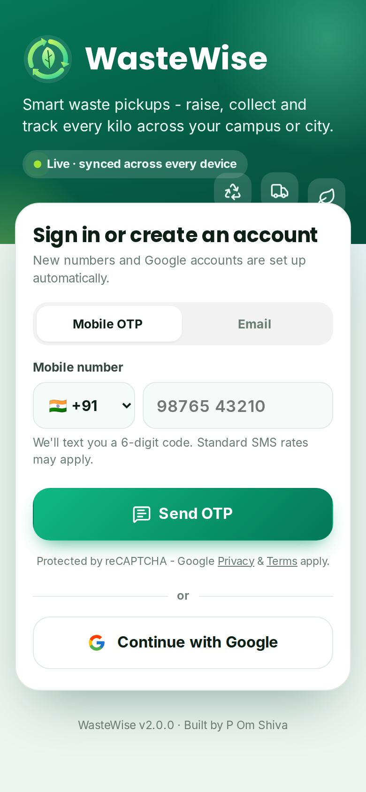 | 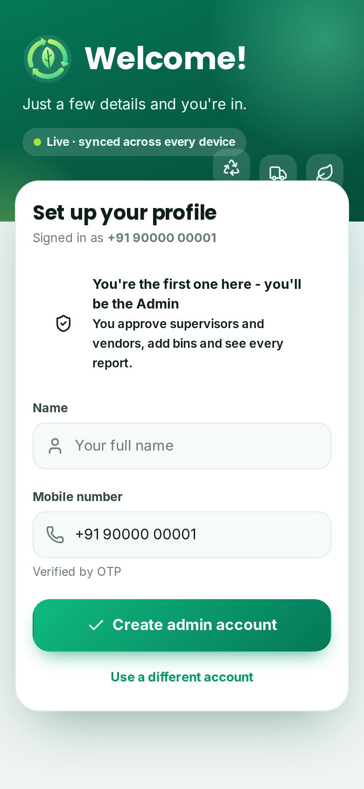 | 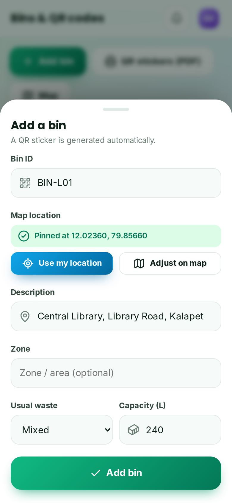 | 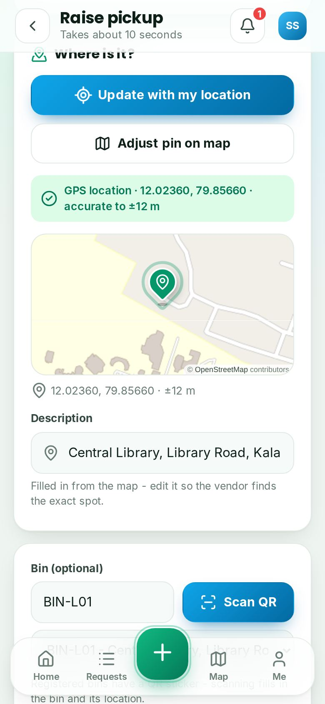 |

| Pickup on the map | Vendor: nearest first | Live map | Directions + call |
|---|---|---|---|
| 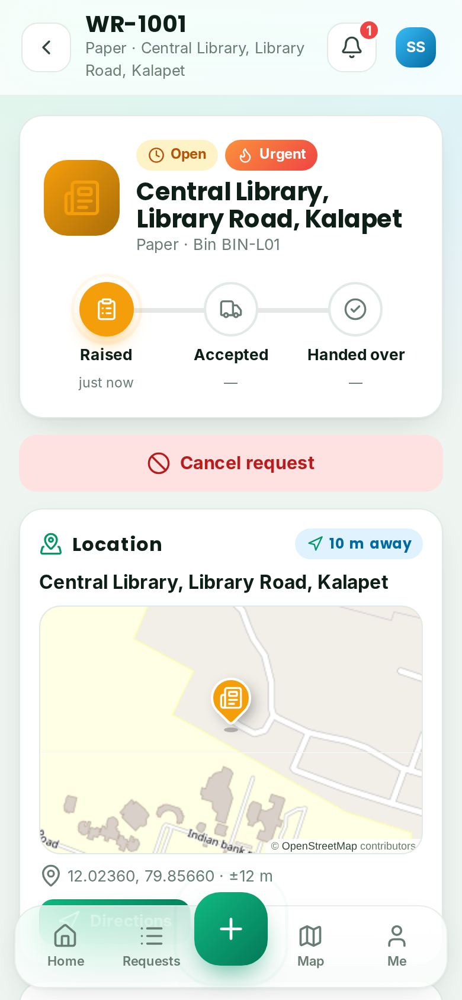 | 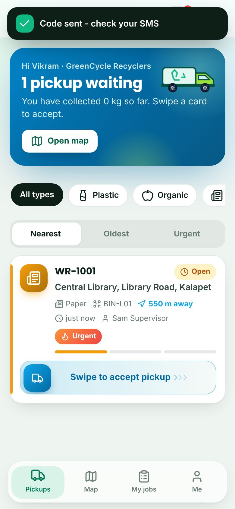 | 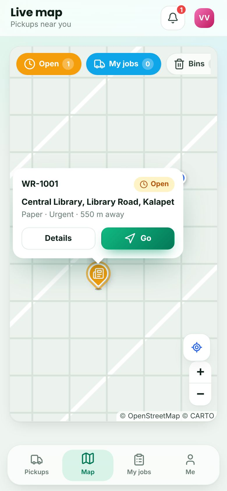 | 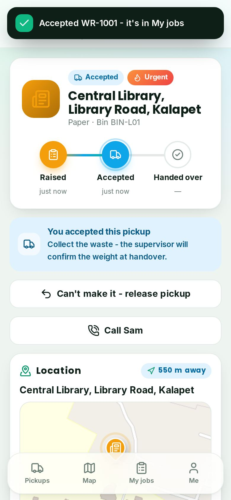 |

| Approvals | Confirm handover | Community impact | Dark mode |
|---|---|---|---|
| 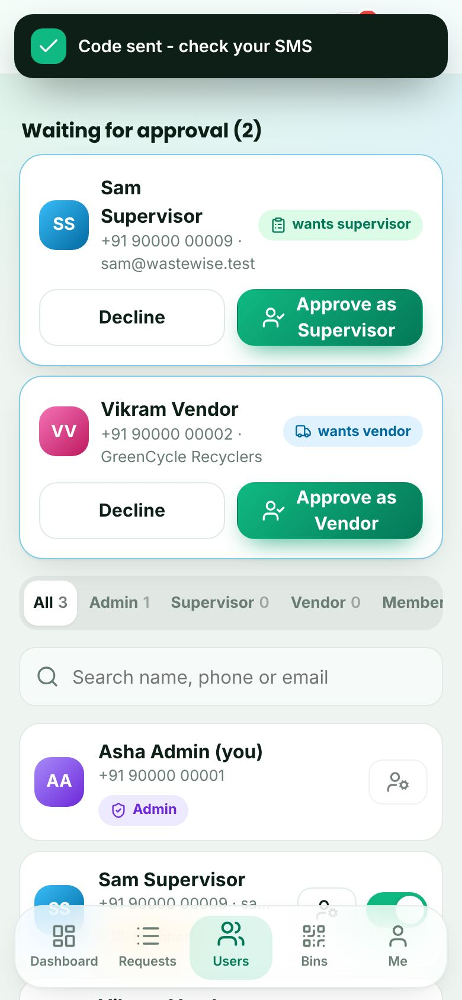 | 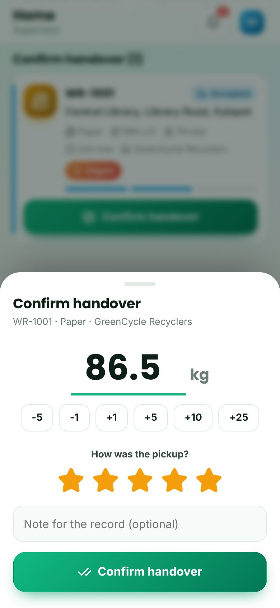 | 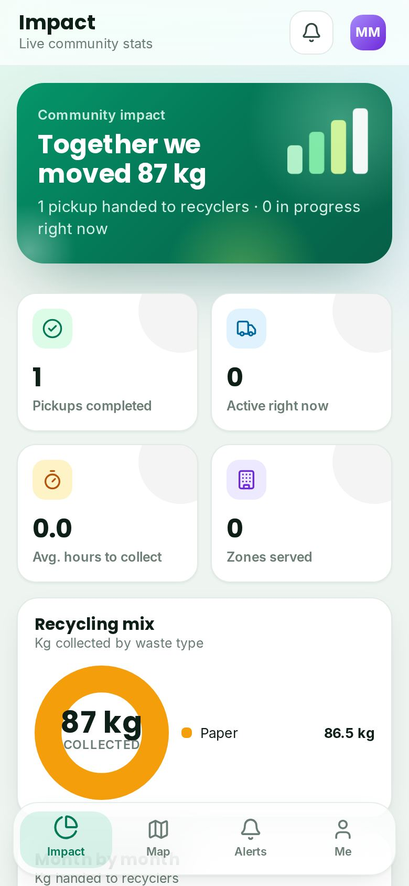 | 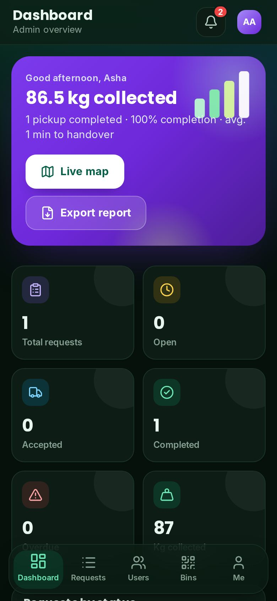 |

**Desktop:**

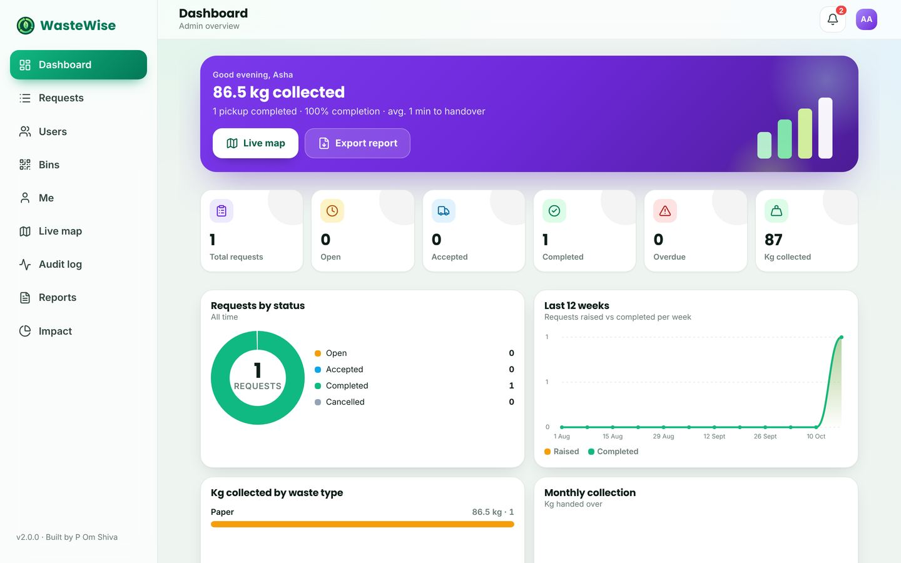

A sample PDF report generated by the app: [docs/sample-report.pdf](docs/sample-report.pdf)

---

## What each role can do

| Role | Screens | Can do |
|---|---|---|
| 🟢 **Supervisor** | Home · Requests · Raise · Map · Reports | Raise a pickup: **GPS location or a pin dropped on the map** (address filled in automatically), optional bin QR, waste type, photo, urgent/normal, notes · see who is coming and **call the vendor** · **confirm handover with weight + star rating** · cancel an open request · PDF / CSV of own requests |
| 🔵 **Vendor** | Pickups · Map · My jobs | Live feed of open pickups **sorted by distance from you** (or oldest / urgent, filter by waste type) · **live map** with your position · **swipe to accept** · **Directions** (Google Maps) and **call the supervisor** · release a pickup they can't make |
| 🟣 **Admin** | Dashboard · Requests · Users · Bins · Live map · Audit log · Reports | Live KPIs and charts · overdue list · **approve supervisor / vendor sign-ups**, change roles, deactivate accounts · add bins **pinned on the map** and **print QR stickers (PDF)** · full audit log · PDF report + CSV export · getting-started checklist with an invite link |
| 🟡 **Member** | Impact · Map · Alerts | Community dashboard: kg collected, recycling mix, month-by-month trend, cleanest zones, top recyclers, recent collections, recycling tips · bins on the map · can apply for vendor / supervisor access |

Everyone gets live **notifications** (bell + toasts), a **profile** page with light/dark theme and haptics, and an **Install app** button.

## Accounts and sign-in

- **Mobile number + OTP** (Firebase phone auth, invisible reCAPTCHA), **email + password** (with password reset) or **Google**.
- A new account first completes a short profile: name, mobile number and the role they want.
- **The very first account becomes the Admin.** Everyone else joins as a member; supervisor and vendor access is approved by the admin, so nobody can give themselves a role.
- Contact numbers travel with each pickup so the vendor and supervisor can call each other.

## Maps and location

- Live maps with [Leaflet](https://leafletjs.com) and [OpenStreetMap](https://www.openstreetmap.org/copyright) tiles; recoloured for dark mode).
- Device GPS on phones (Capacitor Geolocation) and in browsers, with accuracy shown; a full-screen picker to drag the pin, search a place or jump to your location.
- Street addresses from OpenStreetMap Nominatim; one tap opens turn-by-turn directions in Google Maps.
- Vendors' distance labels update live as they move.

## The request lifecycle

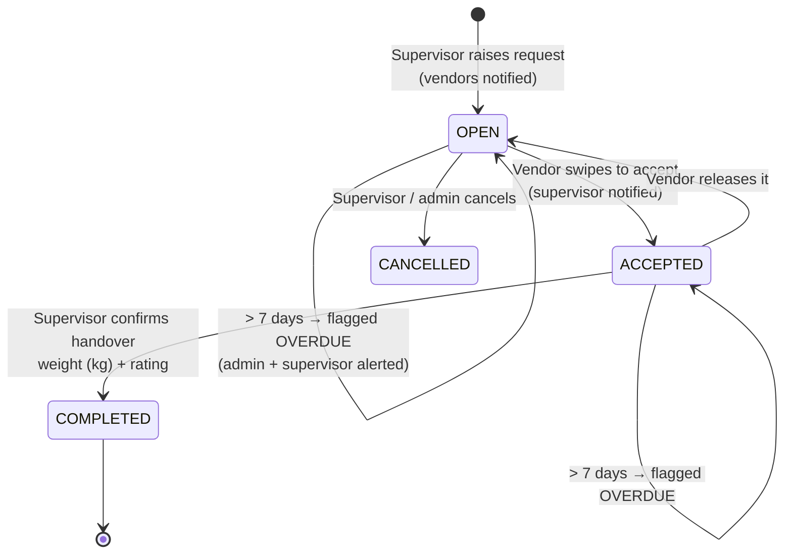

The same rules live in the app (`public/js/core/lifecycle.js`) and in the **Firestore security rules** (`firestore.rules`), so they can't drift. Two vendors can't accept the same pickup: acceptance runs in a Firestore transaction.

## Architecture

Modular layered architecture, as in the original specification:

```text
WasteWise/
├── public/                      # the app (web, PWA and the native apps' web layer)
│   ├── index.html · manifest.webmanifest · sw.js (offline)
│   ├── css/app.css              # design system, components, dozens of animations, dark mode
│   └── js/
│       ├── api/                 # Layer 1 - data access
│       │   ├── auth.service.js · request.service.js · user.service.js
│       │   └── backend/firebase.js   # Firebase Auth (phone / email / Google) + Firestore
│       ├── core/                # Layer 2 - business logic (pure, unit-tested)
│       │   ├── lifecycle.js (state machine + overdue) · rbac.js (roles & route guards) · geo.js (distance, addresses)
│       │   ├── stats.js · report.js + pdf.js (PDF reports) · labels.js (QR stickers) · csv.js
│       ├── ui/                  # Layer 3 - router, shell, charts, maps (Leaflet), GPS, QR scan, camera, native bridge
│       └── pages/               # Layer 4 - feature views: auth/ supervisor/ vendor/ admin/ member/ shared/
├── functions/                   # optional Cloud Functions (Blaze plan): push notifications + 7-day overdue cron
├── firestore.rules · firebase.json
├── capacitor.config.json        # Android / iOS
├── assets/                      # app icon + splash for the native apps
├── tests/                       # unit tests (node:test) + end-to-end browser test (Playwright + Firebase emulators)
└── .github/workflows/           # CI · Android APK · iOS build
```

### Data and security

All data lives in **Cloud Firestore**; the app only talks to it through the `api/` services. **`firestore.rules`** enforce on the server who can read and change what: roles, the pickup lifecycle, the one-time admin setup, field types and sizes, and append-only audit logs. Everything runs on the free Spark plan; the optional Cloud Functions add phone push notifications and the scheduled overdue check. Setup guide: [SETUP_FIREBASE.md](SETUP_FIREBASE.md).

## Design & motion

Custom design system (Poppins + Inter, emerald / lime palette, glassmorphism bars) with **animated SVG illustrations** (driving truck, bins with opening lids, growing charts), **view transitions** between screens, staggered card entrances, animated counters, **drawing charts** (donut, area, bars, columns), a **swipe-to-accept** slider, a **truck "request sent"** animation, **confetti** on handover, ripples, haptics on phones, skeleton loaders and a pulsing overdue badge. Everything respects *Reduce motion* and works in light and dark mode, on phones and on desktop (side navigation).

## Run it locally

No install needed for the web app (zero npm runtime dependencies):

```bash
node scripts/dev-server.js        # http://localhost:5173 (needs your Firebase config in public/js/config.js)
npm test                          # unit tests: lifecycle, roles, location, stats, PDF
node tests/e2e/run.mjs            # full browser test of every role (Playwright, offline stand-in for Firebase)
npm run test:e2e:emulator         # the same test on the real Firebase emulators, including the security rules
```

## Android and iOS apps

GitHub Actions builds the native apps on every push to `main`:

- **Android:** an installable APK is published to the [android-latest release](https://github.com/omshiva24/WasteWise/releases/tag/android-latest). Download it on your phone and open it.
- **iOS:** the app is compiled for the iOS Simulator to prove the build works. Installing on a real iPhone or publishing to the App Store needs an Apple Developer account: on a Mac run `npm install && npx cap add ios && node scripts/native-setup.mjs ios && npx cap open ios`, then press Run in Xcode.
- **Any phone right now:** open the live app and choose **Install** (Android/Chrome) or **Share → Add to Home Screen** (iPhone/Safari).

Native features: GPS location, camera for bin photos, QR scanning, haptics, status bar and splash screen, hardware back button, push notifications (optional, with Cloud Functions). Phone OTP sign-in works in the Android app and the website; Google sign-in works on the website.

To build locally: `npm install`, then `npx cap add android`, `npx capacitor-assets generate`, `node scripts/native-setup.mjs`, `npx cap sync`, `npx cap open android`.

## Security & quality

- Role-based access control in the UI **and** in `firestore.rules`; nobody can give themselves a role (sign-ups start as members and the admin approves).
- Strict Content-Security-Policy, `X-Frame-Options: DENY`, HSTS, `nosniff`; all user text is inserted as text (never as HTML); CSV export is protected against spreadsheet formula injection.
- Location is only read when someone taps a location button or opens the map, and is stored only on the pickups and bins it belongs to.
- Audit log of every action; deactivated accounts lose access immediately.
- Accessible: keyboard navigation (the swipe slider also works with Enter), visible focus rings, ARIA labels and roles, *Reduce motion* support.
- Tested in CI on every push: unit tests plus an end-to-end browser test that signs up an admin, a supervisor, a vendor and a member (phone OTP and email), approves them, pins a bin with GPS, raises a pickup, shows it on the map, accepts, calls, hands over and exports reports - **against the real Firebase Auth and Firestore emulators with the production security rules**.

## How this improves on the original plan

The specification proposed Ionic + React + Recharts + jsPDF. WasteWise keeps the same architecture, roles, lifecycle, Firebase design and Capacitor native apps, and builds the UI layer from scratch with zero npm runtime dependencies:

- **Faster:** no framework to download; the app is about 2 MB including fonts, icons and the map library.
- **Fully custom design and motion** instead of stock components.
- **Extras:** phone OTP sign-in, live maps with GPS and directions, nearest-first pickups for vendors, call buttons, bin QR stickers and scanning, vendor ratings, a release-pickup flow, CSV export, an audit log, PWA install with offline support, and dark mode.

## Credits

Designed and built by **P Om Shiva**. Maps: [Leaflet](https://leafletjs.com) (BSD-2-Clause), map data and tiles © [OpenStreetMap](https://www.openstreetmap.org/copyright) contributors, addresses by [Nominatim](https://nominatim.org). Icons: [Lucide](https://lucide.dev) (ISC). QR generation: [Project Nayuki QR Code generator](https://www.nayuki.io/page/qr-code-generator-library) (MIT). QR scanning fallback: [jsQR](https://github.com/cozmo/jsQR) (Apache-2.0). Fonts: Inter and Poppins (SIL OFL 1.1).
