# ♻️ WasteWise — smart waste pickups

[](https://github.com/omshiva24/WasteWise/actions/workflows/ci.yml) [](https://github.com/omshiva24/WasteWise/actions/workflows/android.yml) [](https://github.com/omshiva24/WasteWise/actions/workflows/ios.yml)  [](LICENSE)

**Bins full? Raise a pickup in 10 seconds. Vendors swipe to collect. Everyone sees every kilo.**

WasteWise connects the people who keep a campus or city ward clean. **Supervisors** raise pickup requests by scanning a bin's QR code, **vendors** see them live and swipe to accept, the supervisor confirms the **handover weight**, and **admins** get live dashboards, overdue alerts after 7 days, an audit log and one-tap **PDF reports**. **Members** see the community's recycling impact.

One codebase runs as a **website**, an **installable app (PWA)** on any phone, and native **Android** and **iOS** apps (Capacitor).

**Live app:** https://wastewise-six-indol.vercel.app
**Android APK:** [Download the latest build](https://github.com/omshiva24/WasteWise/releases/tag/android-latest)
**Created by:** **P Om Shiva**, M.Tech CSE (2nd year), Pondicherry University · [GitHub @omshiva24](https://github.com/omshiva24)
**© 2026 P Om Shiva. All rights reserved.** See [LICENSE](LICENSE).

> **Try it in 5 seconds:** open the live app → tap **Supervisor**, **Vendor**, **Admin** or **Member** under *"or explore instantly as"*. Open a second tab as another role — the two stay in sync live. All demo accounts use the password `demo1234`.

---

## Screenshots

| Supervisor home | Raise a pickup | Vendor: swipe to accept | Confirm handover |
|---|---|---|---|
| 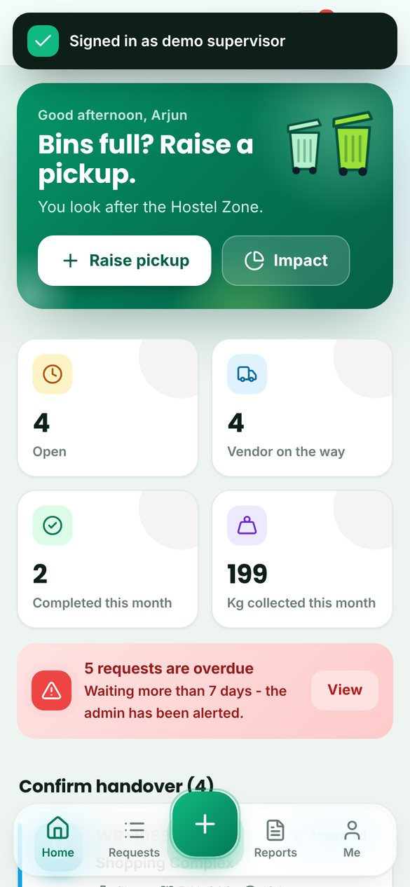 | 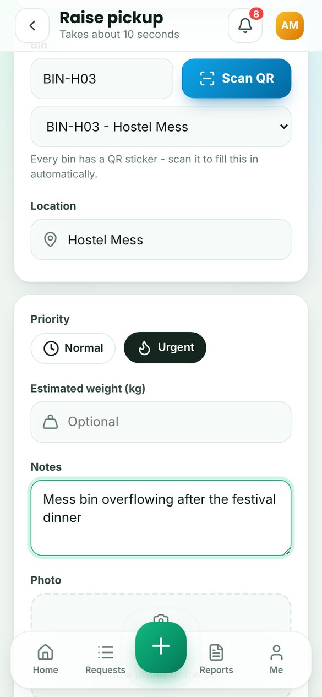 | 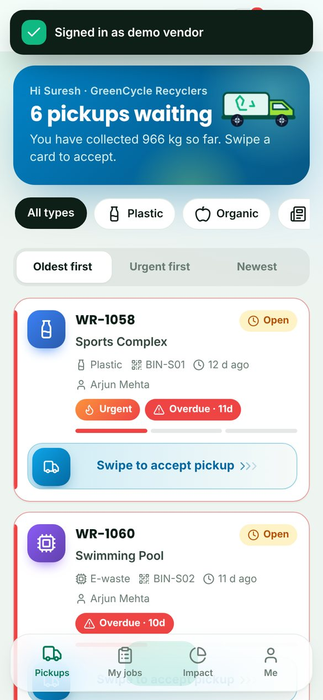 | 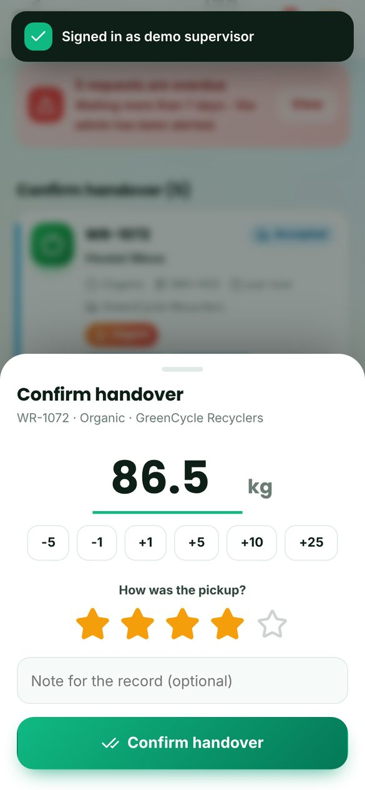 |

| Request timeline | Admin dashboard | Bins & QR stickers | Community impact |
|---|---|---|---|
| 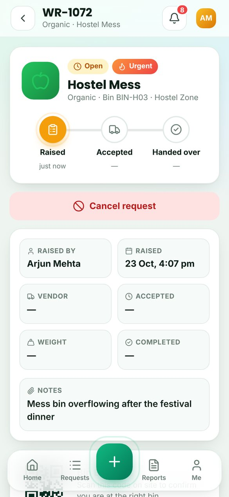 | 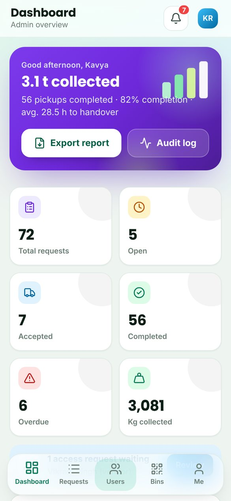 | 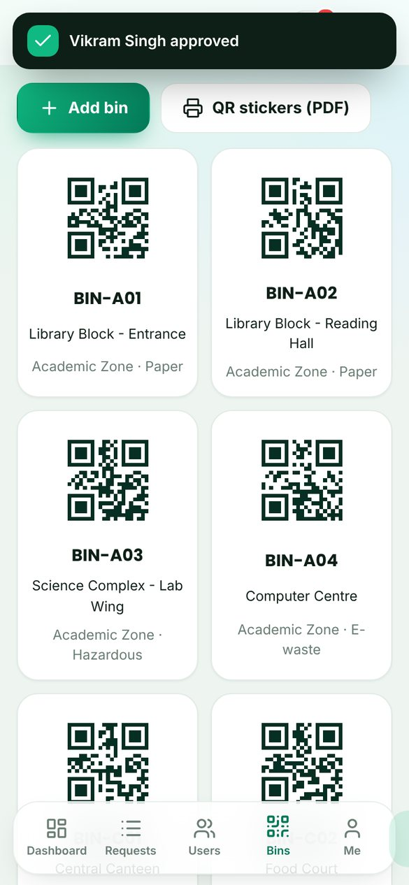 | 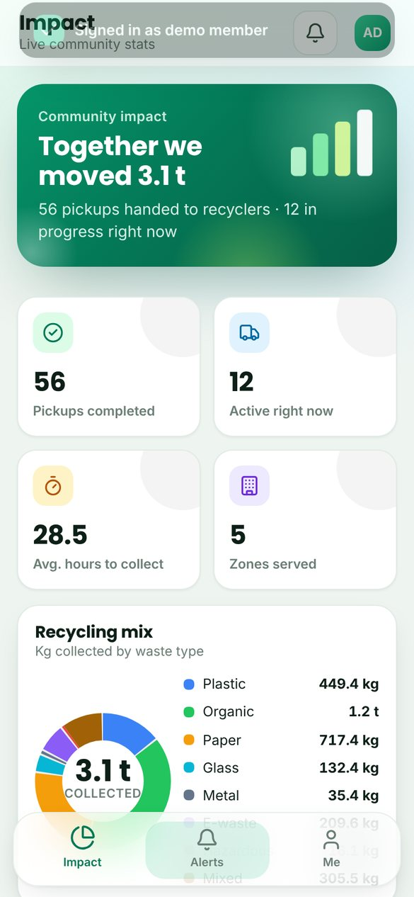 |

| Onboarding | Sign in + demo roles | Dark mode | Users & approvals |
|---|---|---|---|
| 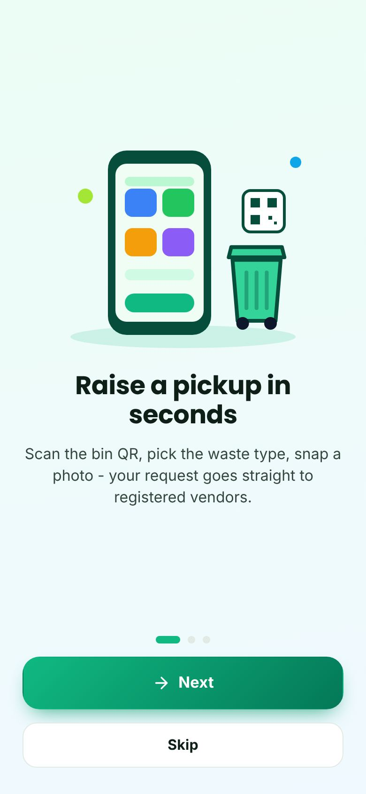 | 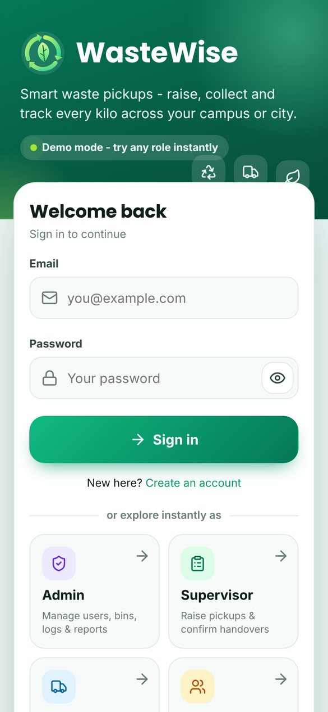 | 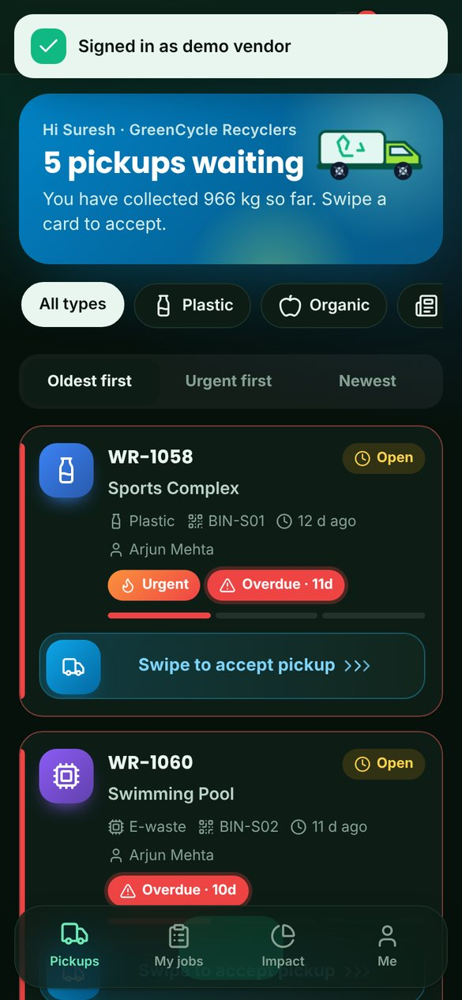 | 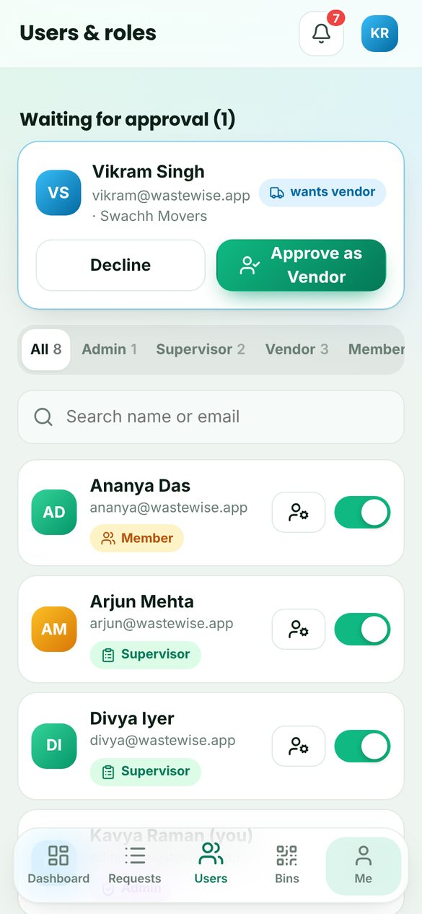 |

**Desktop:**

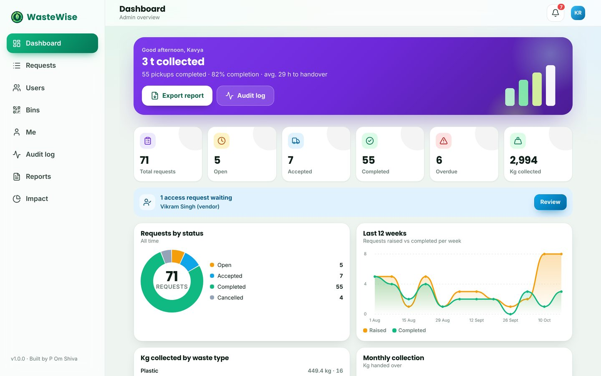

A sample PDF report generated by the app: [docs/sample-report.pdf](docs/sample-report.pdf)

---

## What each role can do

| Role | Screens | Can do |
|---|---|---|
| 🟢 **Supervisor** | Home · My requests · Raise · Reports | Raise a pickup (scan bin QR, pick waste type, photo, urgent/normal, notes) · see the vendor coming · **confirm handover with weight + star rating** · cancel an open request · PDF / CSV of own requests |
| 🔵 **Vendor** | Pickups · My jobs · Impact | Live feed of open pickups (filter by waste type, sort by oldest / urgent) · **swipe to accept** · release a pickup they can't make · stats: jobs, kg, rating, average time |
| 🟣 **Admin** | Dashboard · Requests · Users · Bins · Audit log · Reports | Live KPIs and charts · overdue list · **approve supervisor / vendor sign-ups**, change roles, deactivate accounts · add bins and **print QR stickers (PDF)** · full audit log · PDF report + CSV export |
| 🟡 **Member** | Impact · Alerts | Community dashboard: kg collected, recycling mix, month-by-month trend, cleanest zones, top recyclers, recent collections, recycling tips |

Everyone gets live **notifications** (bell + toasts; push on phones with Firebase), a **profile** page with light/dark theme and haptics, and an **Install app** button.

## The request lifecycle

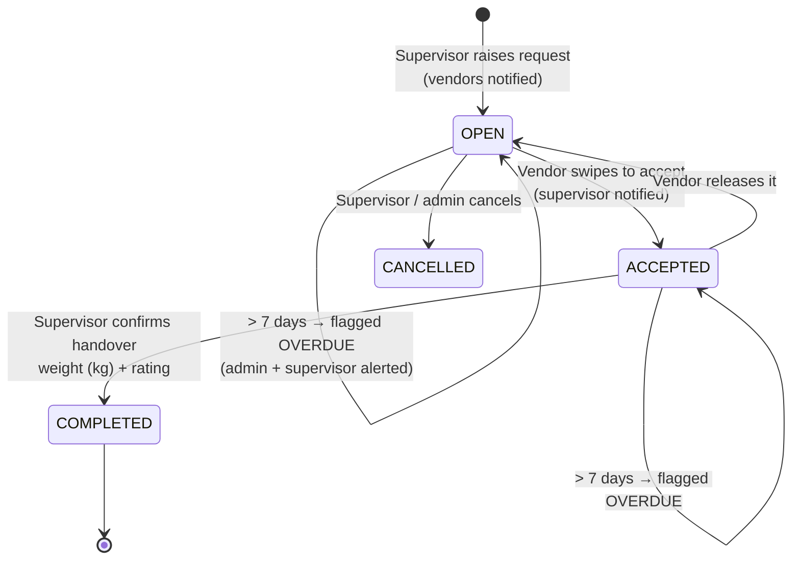

The same rules live in three places so they can't drift: the app (`public/js/core/lifecycle.js`), the **Firestore security rules** (`firestore.rules`) and the **Cloud Functions** (`functions/index.js`). Two vendors can't accept the same pickup: acceptance runs in a Firestore transaction.

## Architecture

Modular layered architecture, as in the original specification:

```text
WasteWise/
├── public/                      # the app (web, PWA and the native apps' web layer)
│   ├── index.html · manifest.webmanifest · sw.js (offline)
│   ├── css/app.css              # design system, components, dozens of animations, dark mode
│   └── js/
│       ├── api/                 # Layer 1 - data access
│       │   ├── auth.service.js · request.service.js · user.service.js
│       │   └── backend/  demo.js (on-device + live tab sync) · firebase.js (Auth + Firestore) · seed.js
│       ├── core/                # Layer 2 - business logic (pure, unit-tested)
│       │   ├── lifecycle.js (state machine + overdue) · rbac.js (roles & route guards)
│       │   ├── stats.js · report.js + pdf.js (PDF reports) · labels.js (QR stickers) · csv.js
│       ├── ui/                  # Layer 3 - components: router, shell, charts, QR scan, camera, native bridge
│       └── pages/               # Layer 4 - feature views: auth/ supervisor/ vendor/ admin/ member/ shared/
├── functions/                   # Layer 5 - Cloud Functions: notifications + 7-day overdue cron
├── firestore.rules · firestore.indexes.json · firebase.json
├── capacitor.config.json        # Android / iOS
├── assets/                      # app icon + splash for the native apps
├── tests/                       # unit tests (node:test) + end-to-end browser test (Playwright)
└── .github/workflows/           # CI · Android APK · iOS build
```

### Data mode

| | Demo mode (default) | Live mode |
|---|---|---|
| Setup | none | paste your Firebase config into `public/js/config.js` ([guide](SETUP_FIREBASE.md)) |
| Data | realistic sample campus: 5 zones, 14 bins, 3 vendors, ~70 requests | your Firestore database |
| Sync | live between tabs of the same browser | live across every phone and computer |
| Notifications | simulated in the app | Cloud Functions + push (FCM) |

The pages never talk to a database directly - only to the `api/` services - so switching mode changes nothing else.

## Design & motion

Custom design system (Poppins + Inter, emerald / lime palette, glassmorphism bars) with **animated SVG illustrations** (driving truck, bins with opening lids, growing charts), **view transitions** between screens, staggered card entrances, animated counters, **drawing charts** (donut, area, bars, columns), a **swipe-to-accept** slider, a **truck "request sent"** animation, **confetti** on handover, ripples, haptics on phones, skeleton loaders and a pulsing overdue badge. Everything respects *Reduce motion* and works in light and dark mode, on phones and on desktop (side navigation).

## Run it locally

No install needed for the web app (zero runtime dependencies):

```bash
node scripts/dev-server.js        # http://localhost:5173
npm test                          # 18 unit tests: lifecycle, roles, stats, demo backend, PDF
node tests/e2e/run.mjs            # full browser test of every role (needs Playwright)
```

## Android and iOS apps

GitHub Actions builds the native apps on every push to `main`:

- **Android:** an installable APK is published to the [android-latest release](https://github.com/omshiva24/WasteWise/releases/tag/android-latest). Download it on your phone and open it.
- **iOS:** the app is compiled for the iOS Simulator to prove the build works. Installing on a real iPhone or publishing to the App Store needs an Apple Developer account: on a Mac run `npm install && npx cap add ios && node scripts/native-setup.mjs ios && npx cap open ios`, then press Run in Xcode.
- **Any phone right now:** open the live app and choose **Install** (Android/Chrome) or **Share → Add to Home Screen** (iPhone/Safari).

Native features: camera for bin photos, QR scanning, haptics, status bar and splash screen, hardware back button, push notifications (with Firebase).

To build locally: `npm install`, then `npx cap add android`, `npx capacitor-assets generate`, `node scripts/native-setup.mjs`, `npx cap sync`, `npx cap open android`.

## Security & quality

- Role-based access control in the UI **and** in `firestore.rules`; nobody can give themselves a role (sign-ups start as members and admins approve).
- Strict Content-Security-Policy, `X-Frame-Options: DENY`, HSTS, `nosniff`; all user text is inserted as text (never as HTML); CSV export is protected against spreadsheet formula injection.
- Audit log of every action; deactivated accounts lose access immediately.
- Accessible: keyboard navigation (the swipe slider also works with Enter), visible focus rings, ARIA labels and roles, *Reduce motion* support.
- Tested: 18 unit tests plus an end-to-end browser test that walks through raise → accept → handover → reports for every role, under the production security policy, in CI.

## How this improves on the original plan

The specification proposed Ionic + React + Recharts + jsPDF. WasteWise keeps the same architecture, roles, lifecycle, Firebase design and Capacitor native apps, and builds the UI layer from scratch with zero runtime dependencies:

- **Faster:** no framework to download; the whole app is under 2 MB including fonts and icons.
- **Fully custom design and motion** instead of stock components.
- **Works the moment it opens:** a demo mode with a realistic dataset, plus live mode with Firebase.
- **Extras:** bin QR stickers and scanning, vendor ratings, a release-pickup flow, CSV export, an audit log, PWA install with offline support, and dark mode.

## Credits

Designed and built by **P Om Shiva**. Icons: [Lucide](https://lucide.dev) (ISC). QR generation: [Project Nayuki QR Code generator](https://www.nayuki.io/page/qr-code-generator-library) (MIT). QR scanning fallback: [jsQR](https://github.com/cozmo/jsQR) (Apache-2.0). Fonts: Inter and Poppins (SIL OFL 1.1).
